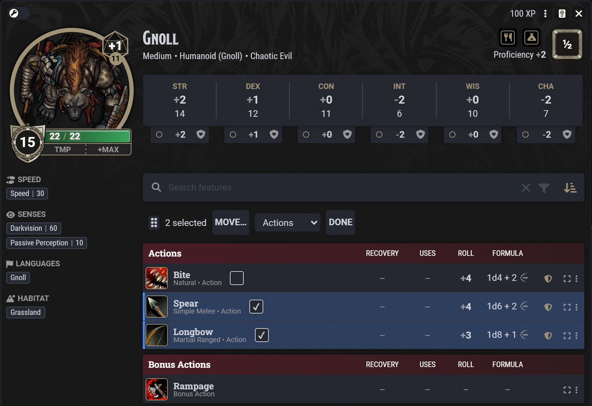
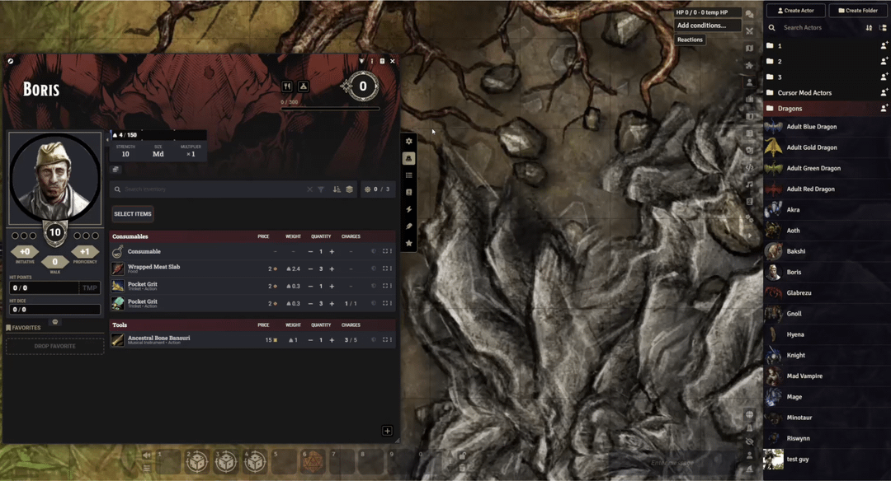

# FileSmith

[Foundry package page](https://foundryvtt.com/packages/filesmith) · [Changelog](CHANGELOG.md) · Help and bug reports: [Discord](https://discord.gg/tcdYk54fxC)

FileSmith V14.4.0 adds group actions to actor sheets and world directories. In the example below, both checked weapons share one action bar. The gallery also shows the transfer review and the two places to right-click in the Items directory.

*Select four items on Boris’s sheet for deletion, then drag nine entries from the Items sidebar onto his inventory.*

## Media

| Shows | File |
| --- | --- |
| Deleting four checked items from Boris’s inventory and adding nine selected sidebar entries | [filesmith-bulk-inventory-actions.gif](https://raw.githubusercontent.com/GnollStack/bakshis-bazaar-archives/main/filesmith/gifs/filesmith-bulk-inventory-actions.gif) |
| Selecting a Gnoll’s Spear and Longbow on its D&D 5e sheet | [filesmith-selected-gear.png](https://raw.githubusercontent.com/GnollStack/bakshis-bazaar-archives/main/filesmith/images/filesmith-selected-gear.png) |
| Duplicating or deleting two checked weapons from the sheet menu | [filesmith-sheet-context-menu.png](https://raw.githubusercontent.com/GnollStack/bakshis-bazaar-archives/main/filesmith/images/filesmith-sheet-context-menu.png) |
| Reviewing quantities before moving gear from a Gnoll to a Minotaur | [filesmith-gear-transfer.png](https://raw.githubusercontent.com/GnollStack/bakshis-bazaar-archives/main/filesmith/images/filesmith-gear-transfer.png) |
| Using counted actions on three selected Items in the sidebar | [filesmith-sidebar-selection.png](https://raw.githubusercontent.com/GnollStack/bakshis-bazaar-archives/main/filesmith/images/filesmith-sidebar-selection.png) |
| Pasting Items at the directory root from the background menu | [filesmith-paste-to-root.png](https://raw.githubusercontent.com/GnollStack/bakshis-bazaar-archives/main/filesmith/images/filesmith-paste-to-root.png) |
| Selecting multiple entries with Ctrl-click | [filesmith-control-click.gif](https://raw.githubusercontent.com/GnollStack/bakshis-bazaar-archives/main/filesmith/gifs/filesmith-control-click.gif) |
| Applying colors and shading to folders | [filesmith-color-folders.gif](https://raw.githubusercontent.com/GnollStack/bakshis-bazaar-archives/main/filesmith/gifs/filesmith-color-folders.gif) |
| Selecting a range of entries with Shift-click | [filesmith-shift-click.gif](https://raw.githubusercontent.com/GnollStack/bakshis-bazaar-archives/main/filesmith/gifs/filesmith-shift-click.gif) |
| Moving folders while keeping their contents together | [filesmith-move-folders.gif](https://raw.githubusercontent.com/GnollStack/bakshis-bazaar-archives/main/filesmith/gifs/filesmith-move-folders.gif) |
